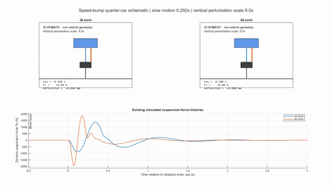
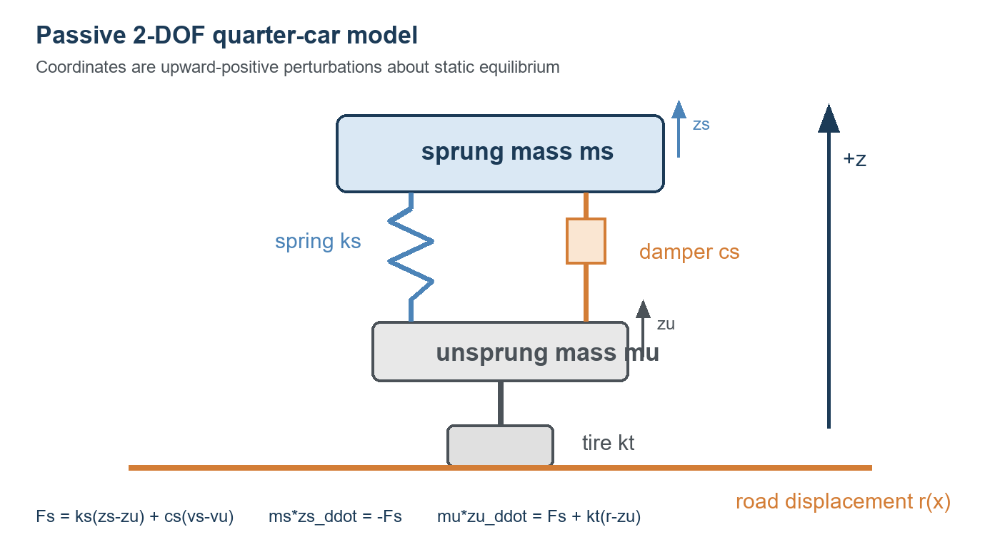

# Automotive Suspension Load Simulation and Load-Spectrum Analysis



An independently developed MATLAB workflow for simulating and evaluating the
vertical dynamic response of a passive quarter-car suspension under multiple
spatial road excitations and vehicle speeds.

## Why this project

The project demonstrates a reproducible engineering workflow: define roads in
distance, simulate the response with `ode45`, calculate response metrics,
validate numerical behavior, count signed suspension-force cycles, and compare
relative load severity. It is a simplified engineering demonstrator, not a
full-vehicle or OEM model.

## Model



The coordinates are perturbations from static equilibrium and are
upward-positive. The signed suspension force is

```text
Fs = ks*(zs - zu) + cs*(vs - vu)
```

and the dynamic equations are

```text
ms*zs_ddot = -ks*(zs-zu) - cs*(vs-vu)
mu*zu_ddot =  ks*(zs-zu) + cs*(vs-vu) - kt*(zu-r)
```

The tire normal-force estimate is `(ms+mu)*g + kt*(r-zu)`. Negative
predictions are retained. A nonpositive estimate marks predicted contact loss;
the trajectory after that point is not treated as a valid unilateral-contact
solution.

## Parameters and roads

| Quantity | Value |
|---|---:|
| Sprung mass `ms` | 320 kg |
| Unsprung mass `mu` | 45 kg |
| Suspension stiffness `ks` | 18,000 N/m |
| Suspension damping `cs` | 1,500 N s/m |
| Tire stiffness `kt` | 190,000 N/m |
| Track length | 500 m |
| Output rate | 200 Hz |

The four roads are smooth, a 60 mm / 3.50 m speed bump, a 45 mm / 1.20 m
pothole, and a deterministic rough road. The same spatial geometry is used at
30 and 60 km/h through `x = v*t`. The rough-road seed is fixed for
repeatability, and raised-cosine ramps avoid an artificial entry step.

## Workflow

```text
spatial road input -> ode45 simulation -> response metrics
                    -> rainflow counting -> relative severity comparison
```

## Run

Requirements:

- MATLAB R2026a or a compatible release;
- Signal Processing Toolbox for the documented MATLAB `rainflow` function.

From the repository root:

```matlab
run_project
```

The command creates `outputs/` automatically, runs all eight road/speed cases,
executes validation, creates figures, performs rainflow analysis when the
toolbox is available, and recreates the animation. Large raw histories and
cycle tables are generated locally and are ignored by Git.

## Repository structure

```text
run_project.m
config/project_configuration.m
src/                       model, roads, simulation, metrics, figures, media
tests/validate_model.m     executable model checks
docs/model_diagram.png     neutral quarter-car diagram
docs/figures/              selected engineering figures
docs/results/              compact executed summaries
media/                     MP4 and compact GIF preview
```

## Selected verified results

- Speed-bump peak `|Fs|`: 1.380 kN at 30 km/h and 1.955 kN at 60 km/h.
- Rough-road full-track RMS `Fs`: 121.67 N at 30 km/h and 187.26 N at 60 km/h.
- Speed-bump severity ratios: `S3(60/30) = 3.884` and `S5(60/30) = 11.130`.
- The complete 60 km/h pothole case is excluded from spectrum comparisons
  after predicted contact loss. Negative normal-force values are not clamped.

## Figures and animation

- [Road geometry](docs/figures/road_geometry.png)
- [Summary comparison](docs/figures/summary_comparison.png)
- [Bump force decomposition](docs/figures/bump_force_decomposition.png)
- [MP4 animation](media/suspension_animation.mp4)

The animation uses existing simulated speed-bump histories, separate sprung and
unsprung positions, fixed scales, a synchronized force cursor, and an explicit
8x perturbation display scale. It is a schematic visualization rather than
vehicle geometry.

## Validation and interpretation

The executed checks cover zero-road response, finite and equal-length outputs,
algebraic force reconstruction, nonnegative damper dissipation, deterministic
repeatability, strict solver convergence, output-sampling sensitivity, and
official MATLAB rainflow interpretation. Rainflow uses complete 500 m histories,
retains half cycles, and applies no filtering. Decaying responses can contain
many negligible-range cycles, so total cycle count alone is not a severity
measure. The severity indicators are dimensionless relative comparisons, not
Miner damage, fatigue life, or a safety assessment.

## Limitations and extensions

This linear 2-DOF model is not Simpack or a full-vehicle model. It omits
unilateral tire contact, nonlinear tire behavior, suspension geometry,
bump-stops, and component-specific stress transfer. Fatigue-related
interpretation would require validated force-to-stress transfer, S-N data,
mean-stress corrections, and additional damage assumptions.

The internal simulation could later be replaced by an adapter that imports
externally generated multibody or measurement CSV data into the same response
schema. Units, signs, sampling, and contact validity should be checked at that
adapter boundary. Parameters in this project are illustrative and are not OEM
data.
